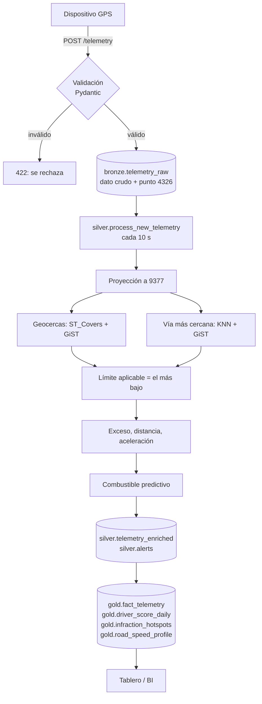

# DESIGN: decisiones de arquitectura

Este documento explica cómo está construido el pipeline, por qué se tomó cada decisión y qué
se sacrificó a cambio. Las cifras de rendimiento se midieron en un portátil con Docker
Desktop; sirven como orden de magnitud, no como garantía.

## 1. Resumen

| Tema | Decisión |
|---|---|
| Base de datos | PostgreSQL 16 + PostGIS 3.4 |
| Arquitectura | Medallón: un esquema por capa (`bronze`, `silver`, `gold`) más `reference` |
| Ingesta | API REST (FastAPI) que valida cada paquete; simulador de dispositivos en Python |
| Procesamiento espacial | SQL basado en conjuntos dentro de PostGIS, orquestado por micro-lotes |
| Sistemas de referencia | Crudo en EPSG:4326; operaciones métricas en EPSG:9377 |
| Geocercas | `ST_Covers` sobre polígonos subdivididos con índice GiST |
| Privacidad | Enmascaramiento en la base (función, vistas y rol) y en las capas que consumen |
| Visualización | Streamlit + Folium (Leaflet) |
| Despliegue | Docker Compose, un comando |

## 2. Flujo de un dato



## 3. Arquitectura del pipeline

### 3.1 Capas

| Capa | Contenido | Regla |
|---|---|---|
| `reference` | Geocercas, vías, equipamientos, vehículos y rutas | Datos maestros, en EPSG:9377 |
| `bronze` | `telemetry_raw` | Solo se agrega; el dato queda como lo envió el dispositivo |
| `silver` | `telemetry_enriched`, `alerts` | Un reporte enriquecido por cada reporte crudo |
| `gold` | `fact_telemetry`, agregados y vistas | Desnormalizado: se consulta sin uniones |

Separar por esquemas hace que los permisos sean simples (el rol de analista solo recibe
vistas de `gold`) y deja claro qué capa es dueña de cada tabla.

### 3.2 Ingesta: API más simulador

Se eligió una API en vez de un script que escriba directo en la base porque así existe un
contrato de datos explícito y un único punto donde validar. `TelemetryPacket` (Pydantic)
rechaza identificadores mal formados, coordenadas fuera de rango, fechas sin zona horaria o
en el futuro y campos desconocidos antes de que lleguen a Bronce.

La ingesta es **idempotente**: `UNIQUE (vehicle_id, reported_at)` con `ON CONFLICT DO NOTHING`.
Los dispositivos reales retransmiten cuando la red falla; un reenvío no duplica datos.

El simulador mueve 12 vehículos por rutas calculadas sobre la malla vial real, con tres
perfiles de conductor (prudente, normal, agresivo) que reaccionan al límite de cada tramo,
consumo de combustible dependiente de la velocidad y pérdidas de cobertura en las que el
dispositivo acumula reportes y los envía juntos al recuperar la señal.

*Trade-off:* HTTP agrega latencia frente a un broker de mensajes. Para el volumen de la
prueba es irrelevante; a gran escala la API pasaría a publicar en una cola (sección 8).

### 3.3 Procesamiento: SQL por micro-lotes

Todo el enriquecimiento ocurre **dentro de la base** con SQL basado en conjuntos. La
alternativa (traer los puntos a Python con GeoPandas y devolverlos) mueve los datos dos
veces por la red y procesa en memoria de un solo proceso; con millones de filas eso no escala
y desaprovecha los índices espaciales, que viven en la base.

`silver.process_new_telemetry()` procesa cada lote en una transacción:

- **Incremental:** una marca de agua (`silver.pipeline_state`) guarda el último
  `telemetry_id` procesado; cada ciclo toma solo lo nuevo.
- **Idempotente:** `ON CONFLICT DO NOTHING` en Plata y en las alertas.
- **Seguro en concurrencia:** un *advisory lock* impide que dos procesos corran a la vez.

Python (`pipeline/runner.py`) solo agenda el ciclo cada 10 segundos y maneja reconexiones.

*Trade-off:* micro-lotes de 10 segundos en lugar de procesamiento evento por evento. Se
pierde inmediatez (una alerta tarda hasta 10 segundos) y se gana eficiencia: las uniones
espaciales por lote son mucho más baratas que una consulta por punto.

**Rendimiento medido:** 13.657 reportes de Bronce a Oro, con alertas y agregados, en 1,4
segundos (unos 9.700 reportes por segundo en un portátil).

### 3.4 Reglas de negocio como funciones puras

Cada regla es una función SQL `IMMUTABLE` pequeña (`silver.applicable_speed_limit`,
`silver.speeding_severity`, `silver.fuel_rate_pct_km`, `silver.is_fuel_insufficient`,
`gold.driver_score`…). Eso permite probar cada una de forma aislada, con valores límite, y
reutilizarlas: el simulador consulta `silver.speed_limit_at()` para conocer el límite de cada
tramo con exactamente la misma regla que usa el pipeline.

## 4. Estrategia de base de datos

### 4.1 PostgreSQL + PostGIS

Se descartó SQLite + SpatiaLite porque no admite escrituras concurrentes (la API, el
pipeline y el tablero acceden a la vez), no tiene roles para el enmascaramiento y sus
índices espaciales (R-tree en tabla virtual) no se integran con el planificador como GiST.

### 4.2 Dos sistemas de referencia

| Dato | SRID | Razón |
|---|---|---|
| Punto crudo en Bronce | 4326 (WGS84) | Es lo que reporta el GPS; el crudo no se altera |
| Capas de referencia y `geom_9377` en Plata | 9377 (MAGNA-SIRGAS 2018 / Origen Nacional) | Sistema proyectado oficial de Colombia, en metros |
| Geometría en Oro | 4326, más columnas `easting_m` y `northing_m` | Los mapas web usan 4326; los reportes, coordenadas planas |

Distancias, radios de búsqueda y la vía más cercana se calculan en un plano en metros, que
es más rápido y simple que la geodesia sobre el elipsoide (`geography`). Cada punto se
proyecta **una sola vez**, al entrar a Plata.

*Trade-off:* almacenar la geometría proyectada cuesta unos 32 bytes más por fila y un índice
adicional, a cambio de no reproyectar en cada consulta.

EPSG:9377 no viene en todas las versiones de PostGIS, así que `001_extensions.sql` lo
registra si falta.

### 4.3 Bronce

```sql
geom geometry(Point, 4326) GENERATED ALWAYS AS
    (ST_SetSRID(ST_MakePoint(longitude, latitude), 4326)) STORED
```

La geometría es una columna generada: la calcula la base a partir de latitud y longitud, de
modo que nunca puede contradecir al dato crudo. Las restricciones `CHECK` son una segunda
línea de defensa detrás de la validación de la API.

Cada fila guarda `reported_at` (cuándo midió el dispositivo) e `ingested_at` (cuándo llegó a
la plataforma). La diferencia es la demora de transmisión, base de los indicadores de salud
del dispositivo. Las cargas históricas se marcan con `is_backfill` para que su antigüedad no
se confunda con una transmisión tardía.

### 4.4 Oro

`gold.fact_telemetry` es una tabla ancha y desnormalizada (nombre de la zona, clase y nombre
de la vía, límite, exceso, combustible, coordenadas en ambos sistemas). Una herramienta de BI
la consume sin uniones. Se carga de forma incremental desde Plata.

Los agregados son vistas materializadas:

| Objeto | Para qué |
|---|---|
| `gold.driver_score_daily` | Variables y puntaje de conducción por vehículo y día |
| `gold.infraction_hotspots` | Infracciones agregadas en grilla de 250 m |
| `gold.road_speed_profile` | Velocidad real observada por vía y hora: costo de tramo para optimización de rutas |

## 5. Índices espaciales

### 5.1 Qué índice para qué consulta

| Tabla | Índice | Consulta que acelera |
|---|---|---|
| `reference.geofence_parts` | GiST (`geom`) | ¿En qué geocercas cae este punto? |
| `reference.roads` | GiST (`geom`) | Vía más cercana (KNN con `<->`) |
| `bronze.telemetry_raw` | GiST (`geom`) | Reportes crudos dentro de un área |
| `bronze.telemetry_raw` | B-tree único (`vehicle_id, reported_at`) | Reporte anterior del mismo vehículo; deduplicación |
| `bronze.telemetry_raw` | BRIN (`reported_at`) | Rangos de tiempo de toda la flota |
| `silver.telemetry_enriched` | GiST (`geom_9377`) | Análisis espacial en metros |
| `gold.fact_telemetry` | GiST (`geom`) | Filtros espaciales de BI |
| `gold.fact_telemetry` | GiST parcial (`geom`) `WHERE is_speeding` | Mapas de calor: solo lee infracciones |
| `gold.fact_telemetry` | B-tree (`vehicle_id, reported_at`) | Trazar la ruta de un vehículo |
| `gold.fact_telemetry` | BRIN (`reported_at`) | Rangos de tiempo |

**Por qué GiST:** es un árbol de rectángulos envolventes. Descarta casi todas las filas
comparando cajas, que es barato, y deja la prueba geométrica exacta para unos pocos
candidatos. Además permite la búsqueda de vecinos más cercanos ordenada por el índice.

**Por qué BRIN para el tiempo:** la telemetría llega ordenada por fecha, así que la posición
física de una fila se correlaciona con su hora. BRIN guarda solo el mínimo y el máximo por
bloque de páginas: ocupa una fracción mínima de lo que ocuparía un B-tree y casi no encarece
las inserciones.

**Por qué un GiST parcial:** las infracciones son una minoría de los reportes. Un índice que
solo las contiene es más pequeño, cabe en memoria y responde antes a las consultas del mapa
de calor.

### 5.2 Subdivisión de polígonos

El perímetro urbano tiene miles de vértices. GiST solo filtra por caja envolvente, y la caja
del perímetro cubre toda la ciudad: no descarta nada, y la prueba exacta recorre todos los
vértices para cada punto.

`reference.geofence_parts` guarda cada geocerca partida con `ST_Subdivide` en trozos de
máximo 128 vértices (16 geocercas se convierten en 271 trozos). El índice descarta la
mayoría de los trozos y la prueba exacta corre contra polígonos pequeños.

*Trade-off:* más filas y un paso de reconstrucción cuando cambia una geocerca
(`reference.rebuild_geofence_parts()`), a cambio de consultas mucho más rápidas. Una prueba
unitaria verifica, sobre una grilla de 1.681 puntos, que la subdivisión no cambia el
resultado.

### 5.3 `ST_Covers` en lugar de `ST_Contains` o `ST_Within`

Los tres operadores coinciden para cualquier punto que no esté exactamente sobre el borde.
La diferencia está en el borde: `ST_Contains` y `ST_Within` lo excluyen, `ST_Covers` lo
incluye. Se eligió `ST_Covers` por dos razones:

1. **Negocio:** un vehículo sobre el límite de una zona de riesgo debe contar como dentro.
2. **Corrección:** al subdividir aparecen bordes internos. Con `ST_Contains`, un punto sobre
   una línea de corte quedaría fuera de los dos trozos vecinos y, por tanto, fuera de una
   geocerca en cuyo interior está.

La equivalencia y la diferencia están cubiertas por una prueba unitaria.

### 5.4 Medición

`python -m fleet_pipeline.benchmark` genera 1.000.000 de puntos y mide las mismas consultas
sin índice y con GiST (mejor de tres ejecuciones según `EXPLAIN ANALYZE`):

| Consulta | Sin índice | Con GiST | Mejora |
|---|---|---|---|
| Reportes dentro de una geocerca (`ST_Covers`) | 216,5 ms | 11,77 ms | 18x |
| Reportes a 300 m de un punto (`ST_DWithin`) | 363,6 ms | 0,53 ms | 681x |
| Los 10 reportes más cercanos a un punto (KNN `<->`) | 103,6 ms | 0,08 ms | 1.264x |

Con índice, las tres responden en milisegundos sobre un millón de registros.

## 6. Lógica espacial y predictiva

### 6.1 Geocercas

`silver.geofences_at(punto)` devuelve todas las geocercas que cubren el punto. Las geocercas
**pueden superponerse** (una zona de siniestralidad está dentro del perímetro urbano); el
modelo lo admite a propósito, porque en una operación real se superponen ciudad, zonas de
riesgo y zonas de clientes, y agregar una geocerca no debe obligar a recortar las demás.

Hay dos tipos: `urban_perimeter` (límite 50 km/h) y `high_accident` (límite 30 km/h).

### 6.2 Límite de velocidad dinámico

```
límite aplicable = el menor entre (límite de la vía más cercana a ≤ 30 m,
                                   el menor límite de las geocercas que cubren el punto)
                   si no hay ninguno: 50 km/h
```

El límite de cada vía viene de OpenStreetMap cuando existe; para los tramos sin dato se
asignó 30 km/h a vías residenciales y a las que están a menos de 100 m de un colegio,
jardín, hospital o clínica, y 50 km/h al resto. Es un supuesto de modelado documentado, no
un dato oficial.

La alerta de exceso tiene una tolerancia de 3 km/h (error de GPS y velocímetro) y tres
niveles: **leve** (hasta 10 km/h sobre el límite), **grave** (hasta 20) y **muy grave** (más
de 20). El mismo vehículo a 45 km/h no comete infracción en una vía de 50, pero sí una grave
dentro de una zona de 30.

### 6.3 Distancia y movimiento

La distancia entre reportes consecutivos de un vehículo se mide en EPSG:9377. Un tramo solo
se cuenta si es válido:

- separación de máximo 300 segundos (más que eso es un viaje nuevo, no un trayecto);
- velocidad implícita de máximo 200 km/h (más que eso es un salto de GPS);
- si el vehículo está detenido en ambos reportes, la distancia es 0 (deriva del GPS).

La aceleración entre reportes detecta maniobras bruscas: aceleración ≥ 2,5 m/s² o frenada
≤ −3,0 m/s².

### 6.4 Consumo predictivo de combustible

La pregunta es: ¿el combustible que queda alcanza para terminar la ruta asignada?

1. **Consumo nominal** (% del tanque por km) = 100 / (capacidad del tanque × rendimiento).
2. **Consumo observado** = combustible gastado / distancia recorrida en los últimos 10
   minutos del vehículo, calculado con funciones de ventana.
3. **Consumo usado:** el observado si hay al menos 1 km de evidencia y el nivel bajó; si no
   (primeros reportes, o hubo un tanqueo), el nominal. El observado se acota entre 0,5 y 3
   veces el nominal para que un sensor ruidoso no produzca predicciones absurdas.
4. **Autonomía (km)** = nivel actual / consumo usado.
5. **Distancia restante (km)** = (1 − posición relativa sobre la ruta) × longitud de la
   ruta, con `ST_LineLocatePoint`.
6. **Alerta** si autonomía < distancia restante × 1,10 (10 % de reserva).

Usar el consumo observado hace que la predicción refleje tráfico, carga y estilo de
conducción reales en vez del dato de catálogo. La alerta se emite **una vez**, en la
transición de suficiente a insuficiente, para no inundar al operador.

### 6.5 Driver Score

Parte de 100 y resta tres penalizaciones con tope, para que ningún factor domine:

| Factor | Cálculo | Tope |
|---|---|---|
| Exceso de velocidad | 100 × (tiempo en exceso ponderado / tiempo de conducción). Peso por gravedad: leve 1, grave 2, muy grave 3; ×1,5 dentro de zona de alta siniestralidad | 50 |
| Maniobras bruscas | 0,5 × eventos por cada 100 km | 25 |
| Combustible | 5 × alertas de combustible insuficiente | 10 |

Se normaliza por tiempo y por distancia para comparar vehículos con distinta exposición. Los
pesos son parámetros de `gold.driver_score` y se calibrarían con datos de siniestralidad
reales.

### 6.6 Alertas y eventos

Plata emite una alerta de exceso por cada reporte en infracción (correcto para un mapa de
calor, donde importa el tiempo de exposición). Para los conteos, el tablero agrupa los
reportes consecutivos en **eventos**: un minuto de exceso es una infracción, no doce.

## 7. Privacidad

El identificador se enmascara como `VHC-****-ABC` en tres niveles:

| Nivel | Mecanismo |
|---|---|
| Base de datos | Función `bronze.mask_vehicle_id`, vistas enmascaradas y rol `fleet_analyst` con permiso solo sobre esas vistas. No puede leer las tablas crudas. |
| API | Sin la clave de administrador, la consulta se hace contra la vista enmascarada: el identificador real nunca sale de la base. |
| Tablero | El rol analista se conecta a la base con el usuario `fleet_analyst`. |

Enmascarar en la base y no solo en la aplicación significa que la protección se mantiene
ante una conexión directa por SQL o desde una herramienta de BI. Un valor con formato
inesperado se enmascara por completo (falla de forma segura).

*Limitación:* el enmascaramiento no es anonimización. Las letras finales siguen
distinguiendo un vehículo de otro, lo cual es intencional (permite analizar por vehículo sin
revelar su identidad) pero no resiste un cruce con otras fuentes.

## 8. Trade-offs para Big Data

Lo implementado prioriza claridad y corrección para el alcance de la prueba. Esto es lo que
cambiaría al pasar a decenas de miles de vehículos y miles de millones de reportes:

| Aspecto | Hoy | A gran escala | Por qué no ahora |
|---|---|---|---|
| Almacenamiento de Bronce y Oro | Una tabla | Particionado declarativo por fecha (mes o día); BRIN por partición; retención borrando particiones | Complica claves y pruebas sin beneficio a este volumen |
| Agregados | Vistas materializadas recalculadas completas en cada ciclo | Agregados incrementales por (vehículo, día) o agregados continuos de TimescaleDB | El recálculo completo es más simple y aquí tarda milisegundos |
| Ingesta | API escribe directo en PostgreSQL | Cola de mensajes (Kafka, Pub/Sub) entre dispositivos y base, con escritura por lotes (`COPY`) | Una cola es otro servicio que operar |
| Marca de agua | Por `telemetry_id` | Por secuencia de confirmación o por registro de cambios (CDC) | Con un solo escritor no hay huecos en la secuencia |
| Datos fuera de orden | Cada dispositivo envía en orden | Reprocesar la ventana afectada cuando llega un dato tardío | Requiere lógica de corrección retroactiva |
| Cercanía a vías | Vecino más cercano a 30 m | *Map matching* con modelo oculto de Markov | El vecino más cercano basta salvo en intersecciones y vías paralelas |
| Agregación espacial | Grilla cuadrada de 250 m | Índice jerárquico H3 | Exige una extensión adicional en la imagen de la base |
| Lectura analítica | La misma instancia | Réplicas de lectura o un motor columnar para históricos | Una instancia atiende de sobra la carga de la prueba |
| Histórico frío | En línea | Archivos Parquet en almacenamiento de objetos | No hay histórico que justifique el costo |

**Limitaciones conocidas**

- **Marca de agua y transacciones concurrentes:** con varios escritores simultáneos, un
  identificador menor podría confirmarse después de uno mayor ya procesado y quedar sin
  procesar. Hoy hay un solo escritor (la API con transacciones cortas).
- **Datos tardíos:** si un reporte antiguo llegara después de procesar uno más nuevo del
  mismo vehículo, la distancia de ese tramo se contaría dos veces. El simulador conserva el
  orden por dispositivo, que es también lo habitual en un equipo AVL que vacía su memoria.
- **Autenticación de dispositivos:** el punto de ingesta no autentica a quien envía. En
  producción cada dispositivo tendría una credencial y el tráfico iría cifrado.
- **Credenciales:** las del repositorio son de demostración; en producción vendrían de un
  gestor de secretos.

## 9. Pruebas

173 pruebas automatizadas (`docker compose run --rm tests`):

| Área | Pruebas | Qué blinda |
|---|---|---|
| Geocercas | 16 | Dentro, fuera, borde, vértice, huecos, multipartes, superposición, subdivisión, proyección |
| Reglas de velocidad y movimiento | 30 | Límite más restrictivo, umbrales de gravedad, vía más cercana, validez de tramos |
| Combustible predictivo | 16 | Consumo nominal y observado, acotamiento, autonomía, reserva, caso desarrollado |
| Pipeline de extremo a extremo | 14 | Un viaje sintético de Bronce a Oro: geocercas, alertas, combustible, idempotencia |
| Driver Score | 10 | Penalizaciones, topes y pesos |
| Privacidad y contrato de datos | 43 | Enmascaramiento, autenticación, validación de paquetes |
| API | 11 | Ingesta, duplicados, rechazos, enmascaramiento por rol |
| Simulador | 16 | Cinemática, combustible, cobertura, reproducibilidad |
| Tablero | 17 | Eventos, salud de dispositivos, segmentos de ruta |

Las reglas espaciales y predictivas viven en SQL, así que sus pruebas corren contra PostGIS
real, en una base separada (`fleet_test`) con un mundo sintético de geometrías simples y
resultados calculables a mano. Cada prueba corre en una transacción que se revierte.

*Trade-off:* estas pruebas necesitan una base de datos, por lo que son algo más lentas que
unas pruebas puramente en memoria (toda la suite tarda unos 3 segundos), pero validan el
código que realmente se ejecuta y no una reimplementación en Python.
