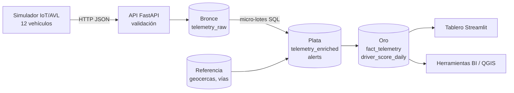

# Fleet Geospatial Pipeline

Pipeline de datos geoespaciales para telemetría de flotas vehiculares (IoT/AVL) con
arquitectura medallón **Bronce → Plata → Oro** sobre **PostgreSQL + PostGIS**, con API de
ingesta, simulador de dispositivos, alertas, Driver Score y tablero interactivo.

Los datos de referencia son reales y de Bogotá D.C.: perímetro urbano, zonas de alta
siniestralidad, malla vial y equipamientos de salud y educación.

Visualizaciones del tablero interactivo.

![[Pasted image 20261122182557.png]]

![[Pasted image 20261122182614.png]]

Link de acceso al video: 
## Qué hace

| Capa | Qué resuelve |
|---|---|
| **Bronce** | API (FastAPI) que recibe y valida los paquetes GPS y los guarda crudos en PostGIS. El identificador del vehículo se enmascara (`VHC-****-ABC`) para quien no es administrador, en la API, en la base de datos y en el tablero. |
| **Plata** | Enriquecimiento espacial en SQL: geocercas, vía más cercana, límite de velocidad dinámico, distancia recorrida, alerta predictiva de combustible y alertas de conducción. |
| **Oro** | Tabla consolidada con índices GiST, Driver Score por vehículo, puntos calientes de infracciones y perfil de velocidad por vía para optimización de rutas. |
| **Tablero** | Streamlit + Leaflet: ruta de cada vehículo, mapa de calor de infracciones, indicadores, salud de los dispositivos y exportación a Excel. |

## Inicio rápido

Requisito: Docker Desktop (o Docker Engine con Compose v2).

```bash
git clone https://github.com/mrdiazo425/fleet-geospatial-pipeline.git
cd fleet-geospatial-pipeline
docker compose up -d --build
```

En uno o dos minutos:

| Servicio | Dirección | Acceso |
|---|---|---|
| Tablero | http://localhost:8501 | `admin` / `admin-secret` (identificadores completos) o `analista` / `analista` (enmascarados) |
| API (documentación interactiva) | http://localhost:8000/docs | Cabecera `X-API-Key: admin-secret` para ver identificadores completos |
| PostGIS | `localhost:5433`, base `fleet` | `fleet` / `fleet` (administrador) o `fleet_analyst` / `analyst` (solo vistas enmascaradas) |

El simulador carga dos horas de historia al arrancar y luego reporta en vivo cada 5 segundos,
así que el tablero tiene datos desde el primer momento.

Pruebas y medición de rendimiento:

```bash
docker compose run --rm tests                                      # 173 pruebas
docker compose run --rm pipeline python -m fleet_pipeline.benchmark  # GiST sobre 1 millón de puntos
```

La guía completa, con verificación paso a paso y solución de problemas, está en
[SETUP.md](SETUP.md). Las decisiones de arquitectura y los trade-offs están en
[DESIGN.md](DESIGN.md).

## Arquitectura



## Estructura del repositorio

```
├── docker-compose.yml        Orquestación: base, carga inicial, API, simulador, pipeline, tablero
├── Dockerfile                Imagen única de Python para todos los servicios
├── sql/                      Esquema y lógica de cada capa (se aplican en orden)
│   ├── 001_extensions.sql    PostGIS y registro de EPSG:9377
│   ├── 010_reference.sql     Geocercas, vías, equipamientos
│   ├── 020_bronze.sql        Telemetría cruda, enmascaramiento, rol de analista
│   ├── 030_silver.sql        Tablas de Plata y reglas de negocio (funciones)
│   ├── 031_silver_pipeline.sql  Proceso por lotes Bronce → Plata
│   └── 040_gold.sql          Tabla consolidada, Driver Score, vistas para BI
├── src/fleet_pipeline/
│   ├── api/                  Ingesta y consulta HTTP
│   ├── simulator/            Dispositivos simulados (cinemática, combustible, cobertura)
│   ├── pipeline/             Orquestador de micro-lotes
│   ├── dashboard/            Tablero: datos, mapa, gráficas, exportación
│   ├── bootstrap.py          Crea el esquema y carga las capas de referencia
│   └── benchmark.py          Medición del efecto de los índices GiST
├── tests/                    Pruebas unitarias (geocercas, combustible, alertas, privacidad…)
├── data/                     Capas de referencia y flota de demostración (GeoPackage)
└── scripts/                  Generador reproducible de las rutas de la flota
```

## Datos de referencia

`data/reference.gpkg` está en EPSG:9377 (MAGNA-SIRGAS 2018 / Origen Nacional) y contiene capas
derivadas de datos abiertos:

| Capa | Contenido | Fuente |
|---|---|---|
| `perimetro_urbano` | Perímetro urbano de Bogotá D.C. | Datos Abiertos Bogotá |
| `zonas_siniestralidad` | 15 zonas críticas de siniestralidad en vías locales (2022-2025) | Secretaría Distrital de Movilidad, Datos Abiertos |
| `vias` | 51.347 tramos de vías vehiculares con límite de velocidad | © OpenStreetMap contributors (ODbL), vía Geofabrik |
| `equipamientos_especiales` | 2.092 colegios, jardines, universidades, hospitales y clínicas | © OpenStreetMap contributors (ODbL), vía Geofabrik |

La telemetría es simulada; ningún dato corresponde a vehículos o personas reales.
